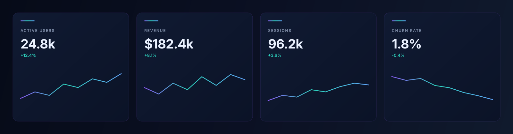

# Execra-DIOS

> repo note: ill update this later lawl



`schema explorer / database inspector / browser UI`

[](https://developer.mozilla.org/en-US/docs/Web/JavaScript)
[](https://developer.mozilla.org/en-US/docs/Web/API)
[](https://en.wikipedia.org/wiki/Comma-separated_values)
[](https://github.com/xormant/Execra-DIOS)

┌──────────────────────────────────────────────────────────────────────────────┐
│ Execra-DIOS is a lightweight browser UI for inspecting database metadata, │
│ browsing table data, and reviewing values in a clean, structured view.     │
└──────────────────────────────────────────────────────────────────────────────┘

## Overview

Execra-DIOS is a compact database inspection interface built around a single in-memory payload. It renders tables, column metadata, and row-level data directly in the browser, with support for filtering, sorting, and CSV export.

The project is intentionally simple: it reads `window.execraData`, displays the available tables and columns, and lets a user browse the data without a separate backend.

## Highlights

- Table dashboard with table counts and metadata
- Column inspector for schema details and null/key state
- Browser-style table view with row filtering
- Column-value breakdown with frequency counts
- CSV export for full table or focused column views
- Dark and light theme toggling

## Interface flow

The app works in a straightforward browser flow:

- Load the page
- Provide `window.execraData`
- Let the UI render the table list
- Drill into columns or row data
- Filter, sort, and export as needed

## Usage

The current implementation expects a browser page that loads `ex.js` and `ex.css`, then supplies structured data on `window.execraData`.

```html
<link rel="stylesheet" href="./ex.css" />
<script src="./ex.js"></script>

<script>
  window.execraData = {
    tables: [
      { name: "users", columnCount: 5 },
      { name: "orders", columnCount: 7 }
    ],
    columns: {
      users: [
        { name: "id", type: "INT", nullable: false, key: "PRIMARY" },
        { name: "email", type: "VARCHAR", nullable: false, key: "" }
      ]
    },
    tableData: {
      users: [
        { id: 1, email: "user@example.com" }
      ]
    },
    columnData: {
      users: {
        email: ["user@example.com", "admin@example.com"]
      }
    }
  };
</script>
```

This repository is a front-end presentation layer for the data payload; the JavaScript reads the structure and renders it into the UI automatically.

## Project structure

```text
Execra-DIOS/
├── ex.js
├── ex.css
├── README.md
└── assets/
    └── execra-banner.svg
```

- `ex.js` — UI logic, rendering, filters, sorting, CSV export
- `ex.css` — styling and theme behavior
- `assets/execra-banner.svg` — local terminal-inspired banner for the project header

## Notes

The interface includes:
- dynamic table discovery from the payload
- schema browsing by table and column
- row browsing and dataset filtering
- export support to CSV
- theme switching for dark/light viewing modes

## License

This repository does not currently include a license file in the project root.

## Asset note

The banner asset is stored locally in `assets/execra-banner.svg` and is designed to match the repository’s terminal/TUI aesthetic without requiring external image dependencies.

---

┌──────────────────────────────────────────────────────────────────────────────┐
│ Built for a clean, terminal-inspired GitHub presentation.                 │
└──────────────────────────────────────────────────────────────────────────────┘
